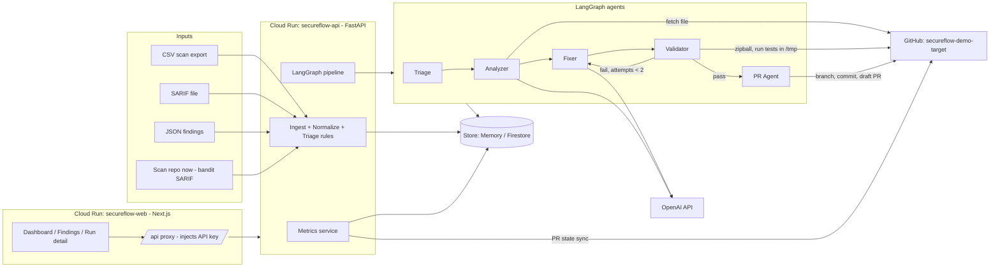

# SecureFlow AI

> Autonomous, Multi-Agent Vulnerability Remediation Pipeline  
> **Problem Statement 09 (PS-09): Automating Application Security Remediation & Backlog Management**

---

## 1. The Problem

Application security scanners (SAST, SCA, secrets detection) generate thousands of vulnerability findings that overwhelm development teams. The average security finding remains open for over **90 days**, consuming an estimated **6.8 hours of manual engineering effort per fix** to investigate, recreate, write safe code, verify regressions, and open pull requests. Scanner suggestions are frequently missing, incomplete, or unsafe to apply without manual testing.

## 2. The Solution

SecureFlow AI is an autonomous 5-agent pipeline that turns static scanner reports into review-ready, regression-tested draft pull requests:
1. **Triages and prioritizes** findings using deterministic risk formulas and data-quality validation.
2. **Analyzes root causes and relocates drifted lines** using live Abstract Syntax Tree (AST) caller graphs.
3. **Generates surgical patches and validates them** in a multi-gate sandbox (AST policy, compiler, functional tests, exploit tests, and Bandit differential analysis) before opening a verified draft PR.

---

## 3. Architecture



### The 5 Autonomous Agents
- **Triage Agent:** Deterministic policy gate. Scores priority (`0.4*sev + 0.3*exploit + 0.2*recency + 0.1*conf`), flags data-quality anomalies (drift, description mismatches, duplicates), and assigns remediation tier (`AUTO_FIX`, `DEPENDENCY`, `ESCALATE`, `UNSUPPORTED_LANG`).
- **Analyzer Agent:** Inspects source code hierarchy via GitHub API. Re-locates drifted line numbers using AST function inspection, identifies root cause, and provides strict patch guidelines.
- **Fixer Agent:** Generates surgical, full-file replacements using OpenAI structured JSON mode. Rejects regex truncation and preserves existing comments and code formatting.
- **Validator Agent:** Enforces 5 strict validation gates in an isolated sandbox (`ast.parse`, forbidden call blacklists, line budget ≤ 80, `py_compile`, pytest functional tests, exploit tests, and Bandit differential security analysis). Loops back to the Fixer on failure (up to 2 retries).
- **PR Agent:** Creates isolated branch, commits passing patch, and opens a review-ready **Draft PR** with complete before/after evidence tables. *(Hard rule: Agents never auto-merge).*

---

## 4. Technology Stack & Cloud Services

- **Backend:** Python 3.12, FastAPI, LangGraph, Pydantic v2, PyGithub, Bandit, Pytest.
- **Frontend:** Next.js 14 (App Router), TypeScript, Tailwind CSS, Recharts, SWR, Lucide Icons.
- **LLM Engine:** OpenAI `gpt-4o` (Analyzer, Fixer) & `gpt-4o-mini` (Triage, summary).
- **GCP Infrastructure:** Google Cloud Run (`secureflow-api` and `secureflow-web`), Cloud Build, Artifact Registry, Google Cloud Firestore.

---

## 5. Local Setup & Running (Windows cmd)

### Prerequisites
- Python 3.12+ installed
- Node.js 20+ installed
- OpenAI API Key & GitHub Personal Access Token (scoped to demo repo)

### Step 1: Backend Setup
```cmd
cd backend
python -m venv .venv
call .venv\Scripts\activate
pip install -r requirements.txt
copy .env.example .env
:: Edit .env with your OPENAI_API_KEY and GITHUB_TOKEN
uvicorn app.main:app --host 127.0.0.1 --port 8080 --reload
```
The API is available at `http://localhost:8080`. Automatic seeding loads `backend/data/ps09_vulnerability_scans.csv` on first startup.

### Step 2: Frontend Setup
```cmd
cd ..\frontend
copy .env.local.example .env.local
npm install
npm run dev
```
Open `http://localhost:3000` to interact with the SecureFlow AI dashboard.

### Step 3: Run Unit & Contract Tests
```cmd
cd ..\backend
call .venv\Scripts\activate
pytest -q
```
*(65 automated tests verify ingestion, AST policy rules, sandbox execution, LangGraph routing, PR sync, and metrics calculation).*

---

## 6. Cloud Run Deployment

### Backend Deploy
```cmd
cd backend
gcloud run deploy secureflow-api ^
  --source . ^
  --region asia-south1 ^
  --allow-unauthenticated ^
  --env-vars-file ..\env.prod.yaml ^
  --no-cpu-throttling ^
  --min-instances 1 ^
  --max-instances 2 ^
  --memory 1Gi ^
  --cpu 1 ^
  --timeout 900
```

### Frontend Deploy
```cmd
cd ..\frontend
gcloud run deploy secureflow-web ^
  --source . ^
  --region asia-south1 ^
  --allow-unauthenticated ^
  --env-vars-file ..\env.web.yaml ^
  --min-instances 0 ^
  --max-instances 2 ^
  --memory 512Mi ^
  --cpu 1
```

---

## 7. Assumptions & Honesty Note

> **Honesty Note:** The PS-09 dataset `ps09_vulnerability_scans.csv` is synthetic historical data provided for the challenge. `secureflow-demo-target` was constructed specifically to mirror 8 real vulnerability patterns from this dataset with working exploit and regression test suites. **All agent analyses, code patches, sandbox test executions, and draft PRs are generated 100% live** during remediation runs.

- **Backlog Timeline Assumption:** The input CSV contains `days_open` but no absolute calendar scan dates. The live backlog timeline starts at the CSV baseline (96 open findings) and tracks changes in real time as PRs are opened, reviewed, and merged.
- **Safety Policy:** SecureFlow AI creates **Draft Pull Requests only**. It strictly enforces human-in-the-loop verification before merge.

---

## 8. Roadmap

- **Persistent Multi-Region Storage:** Firestore document caching and Cloud Tasks asynchronous job queue.
- **GitHub App Integration:** Bi-directional webhooks to trigger remediations automatically when security scanning tools push SARIF reports to GitHub Security Advisories.
- **Multi-Language Adapters:** AST parser extensions and sandbox runtime images for TypeScript/JavaScript (Node.js/npm), Java (Maven/SpotBugs), and Go (Gosec).
